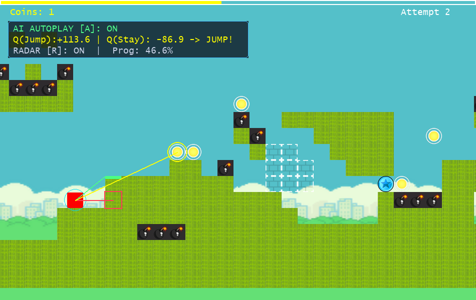
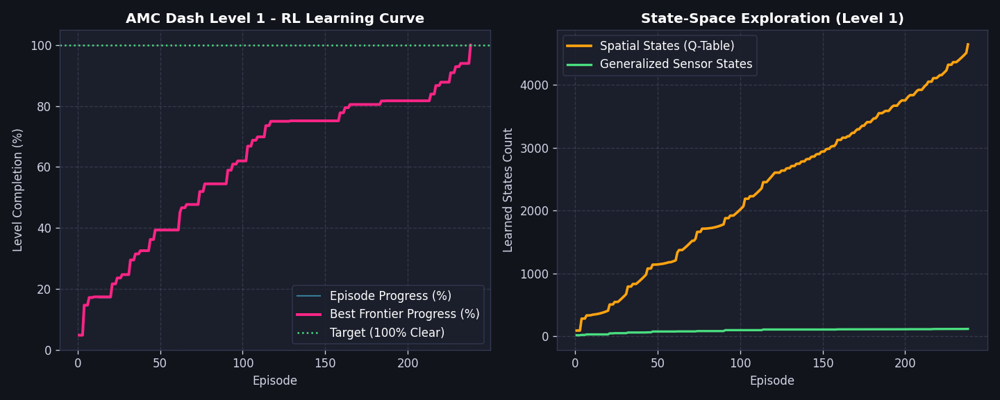
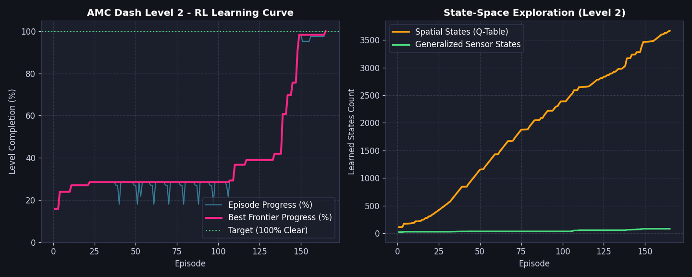

# AMC Dash 🎮🤖
**Geometry Dash Clone & Autonomous Reinforcement Learning Agent in Python**

Proyek portofolio yang menggabungkan pengembangan game platformer presisi berbasis **Pygame** dengan agen **Reinforcement Learning (RL)** yang mampu belajar menamatkan seluruh level secara mandiri dari nol (*zero prior knowledge*).



---

## 🌟 Sorotan Teknis & Konsep Reinforcement Learning (Portfolio Highlights)

Game platformer presisi seperti *Geometry Dash* memiliki tantangan klasik dalam Reinforcement Learning yang berhasil diselesaikan di proyek ini:

1. **Direct Headless Simulation (~2.300 FPS)**
   * Menggantikan metode *screen-capture* (`mss` + `pytesseract` + `pydirectinput`) yang lambat ($\approx 20\text{ FPS}$) dengan simulasi *headless* langsung di dalam [`AMCDashEnv`](file:///c:/Users/anjum/.gemini/antigravity/scratch/AMC_Dash/ai/env.py), mempercepat proses pelatihan lebih dari **100x lipat**.
2. **Dual-Layer RL Architecture (Sensor Generalization + Spatial Bellman)**
   * **Layer 1 — Relative Radar Sensor Policy (`sensor_q_table`)**: Mengekstrak 8 fitur sensor relatif (jarak & elevasi ke rintangan/duri terdekat, tepi platform berikutnya, dan *Jump Orb*) tanpa koordinat $x$ absolut untuk mendukung *generalization*.
   * **Layer 2 — Backward Bellman Trajectory Sweep (`q_table`)**: Menyelesaikan masalah *Delayed Credit Assignment* (lompatan 32 frame di udara) menggunakan penyapuan mundur persamaan Bellman:
     $$Q(s_t, a_t) \leftarrow r_t + \gamma \max_{a'} Q(s_{t+1}, a')$$
3. **Mid-Air Action-Space Masking (Physics Prior)**
   * Saat kubus melayang di udara (tanpa menyentuh *Jump Orb*), aksi `JUMP` dan `NO_OP` menghasilkan lintasan fisika yang identik ($Q(s, \text{JUMP}) = Q(s, \text{NO\_OP})$). Teknik ini memangkas ruang pencarian dari $2^{32}$ kombinasi udara menjadi **1 keputusan tunggal saat lepas landas** (*takeoff*).
4. **Zero-Baseline Backtracking & Go-Explore Checkpoints**
   * Mengadopsi prinsip *Go-Explore* (*"First Return, Then Explore"*) dengan *unbroken parent trajectory backup*. Ketika suatu percabangan rute terbukti buntu ($\max_a Q(s, a) < 0$), agen secara otomatis membatalkan checkpoint buntu tersebut dan memilih rute alternatif (seperti memanjat tangga atas di Level 1 & Level 2).
5. **Real-Time AI Radar Raycast & Telemetry HUD**
   * Visualisasi langsung di layar Pygame yang menampilkan garis sensor laser (**Merah**: Bahaya/Duri/Dinding, **Hijau**: Pijakan Platform, **Kuning**: *Jump Orb*) beserta panel nilai keputusan $Q(\text{Jump})$ vs $Q(\text{Stay})$ secara *real-time*.

---

## 📊 Hasil Pelatihan & Learning Curve

| Metrik | Level 1 (`level_1.csv`) | Level 2 (`level_2.csv`) |
| :--- | :---: | :---: |
| **Status Penyelesaian** | **100.0% Tamat (Verified)** 🏆 | **100.0% Tamat (Verified)** 🏆 |
| **Panjang Level** | $11.552\text{ px}$ ($1.893\text{ frames}$) | $4.416\text{ px}$ ($704\text{ frames}$) |
| **Episode hingga Tamat** | $238\text{ Episode}$ | $165\text{ Episode}$ |
| **Waktu Pelatihan** | **$\approx 3,95\text{ detik}$** ($2.282\text{ FPS}$) | **$\approx 4,45\text{ detik}$** ($2.200\text{ FPS}$) |
| **States Dipelajari** | $4.644\text{ Spatial}$ / $118\text{ Sensor}$ | $3.668\text{ Spatial}$ / $81\text{ Sensor}$ |

### Kurva Pembelajaran Level 1


### Kurva Pembelajaran Level 2 (Termasuk Backtracking Rute & Mekanik Yellow Orb)


---

## 📁 Struktur Proyek

```text
AMC_Dash/
├── game/
│   ├── config.py         # Konstanta window, fisika (gravitasi, lompatan), warna & path aset
│   ├── obstacles.py      # Hirarki kelas rintangan (Platform, Spike, Coin, Orb, Trick, End)
│   ├── player.py         # Fisika kubus, prioritas Orb, resolusi tabrakan & partikel
│   ├── level.py          # LevelLoader (parser map CSV)
│   └── engine.py         # GameEngine (State Machine, AI Radar Raycast HUD & Headless API)
├── ai/
│   ├── env.py            # AMCDashEnv (Gymnasium Environment: 8-Sensor Radar & 84x84 RGB)
│   ├── agent.py          # QLearningDashAgent (Dual-Layer Sensor + Spatial Bellman Sweep)
│   ├── train.py          # Skrip pelatihan RL + generator grafik Learning Curve otomatis
│   └── evaluate.py       # Skrip visualisasi agen AI bermain secara real-time
├── tests/
│   ├── test_engine.py    # Unit test simulasi engine game
│   └── test_env.py       # Unit test Gymnasium environment
├── train/
│   ├── q_agent_level_1.json  # Model RL Level 1 (100% Clear)
│   └── q_agent_level_2.json  # Model RL Level 2 (100% Clear)
├── main.py               # Entry point utama (mendukung mode Manual & AI Autoplay)
└── requirements.txt      # Dependensi proyek
```

---

## 🚀 Cara Menjalankan

### 1. Bermain Game + Toggle AI Live (`main.py`)
```bash
# Mode interaktif (bisa berganti antara Manual & AI kapan saja di dalam game):
python main.py

# Atau langsung aktifkan AI Autoplay sejak awal:
python main.py --ai --level 1
```
**Kontrol di Dalam Game:**
* **`[SPACE]` / `[UP]`** : Melompat / Memicu *Yellow Orb* di udara (saat mode Manual)
* **`[A]`** : Menyalakan / Mematikan **AI Autoplay** secara langsung (*real-time*)
* **`[R]`** : Menyalakan / Mematikan **Visualisasi Radar Sensor AI & Telemetri Q-Value**
* **`[1]` / `[2]`** : Memilih Level 1 atau Level 2 pada Menu Utama
* **`[ESC]`** : Kembali ke Menu / Keluar

### 2. Menonton Evaluasi Agen AI (`ai/evaluate.py`)
```bash
# Menonton AI menamatkan Level 1 lengkap dengan garis Radar HUD:
python ai/evaluate.py --level 1

# Menonton AI menamatkan Level 2 (dengan rintangan Yellow Orb & Koin):
python ai/evaluate.py --level 2
```

### 3. Melatih Ulang Agen AI dari Nol (`ai/train.py`)
```bash
python ai/train.py --level 1 --episodes 500
python ai/train.py --level 2 --episodes 500
```
